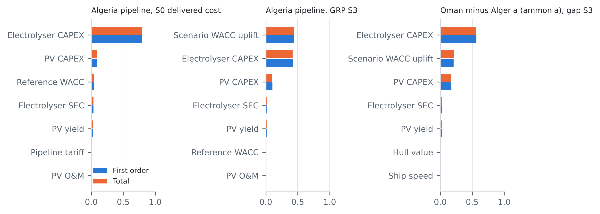

**Supplementary Material**

**Pricing geopolitical risk into delivered green hydrogen costs: a route-explicit scenario framework for Algeria–EU supply tested on the 2026 Strait of Hormuz closure**

Rabia Bousbia Laiche, Fethi Letaim, Erdem Cuce

This Supplementary Material reports the full parameter set, the route inputs, the complete scenario and competitor results, the sensitivity analysis, the model variants, the 2030 calibration and the observed 2026 data used in the article. Every table is written by the code in the accompanying repository (Bousbia Laiche et al., 2026), and the numbering of the article's equations, tables and figures is used throughout.

# S1. Reproducibility

All results were produced with model version 2.1.0, Python 3.13.18 and numpy 2.5.3, with 10,000 Monte Carlo draws and seed 20251113. Sobol indices use SALib 1.6.0 (Herman and Usher, 2017) and sea distances the searoute package 1.6.0 (Halili, 2024). The SHA-256 hash of the parameter files used for the 2023 calibration is 6214303414cf89e1… (full value in outputs/calibration_2023/run_log.json). The commands are:

`pip install -r requirements.txt`; `python src/run_model.py --calibration 2023`; `python src/run_model.py --calibration 2030`; `pytest tests`.

A full 2023 run, including the Sobol design (30,720 model evaluations) and the figures, takes well under one minute on a laptop. The Geopolitical Risk index workbook (Caldara and Iacoviello, 2022) is read from data/raw/gpr_export.xls, which users download from its authors because it is not redistributed with the repository.

# S2. Parameters

Table S1. Techno-economic parameters of the 2023 calibration (params/production.yaml). Tri(a, b, c): triangular with minimum a, mode b and maximum c. AUTHOR: author assumption. Source keys are resolved in docs/REFERENCES.md and in the reference list below.

| Parameter (code name) | Value | Unit | Source key |
|---|---|---|---|
| pv_capex_usd_per_kw | Tri(550, 758, 950) | USD2023/kW | IRENA_2024 |
| pv_fixed_om_usd_per_kw_yr | Tri(9, 12, 15) | USD2023/kW/yr | AUTHOR |
| pv_yield_factor | Tri(0.95, 1, 1.05) | multiplier on the site PVOUT in countries.yaml | GSA_2026 |
| pv_lifetime_yr | 25 | yr | AUTHOR |
| el_capex_usd_per_kw | Tri(750, 1300, 2000) | USD/kW (installed) | IEA_2023 |
| el_fixed_om_share | 0.025 | share of CAPEX per yr | AUTHOR |
| el_lifetime_yr | 20 | yr | AUTHOR |
| el_sec_kwh_per_kg | Tri(50, 53, 56) | kWh/kg H2 | AUTHOR |
| el_to_pv_ratio | 0.7 | kW_el per kWp | AUTHOR |
| clipping_loss | 0.03 | share of PV output | AUTHOR |
| water_m3_per_kg | 0.035 | m3 desalinated water per kg H2 | PtXHub_2024 |
| desal_cost_usd_per_m3 | Tri(0.6, 1, 1.5) | USD/m3 | AUTHOR |
| pipeline_transport_eur_per_mwh | Tri(9, 14, 19) | EUR/MWh (LHV) | Timmerberg_2019 |
| nh3_chain_10k_usd_per_kg | Tri(2.5, 3.5, 4.5) | USD/kg H2 | IRENA_2022b |
| ship_speed_kn | Tri(14, 15, 17) | knots | AUTHOR |
| ship_port_days_per_call | 2 | days per port call (two calls per round trip) | AUTHOR |
| ship_operating_days_yr | 350 | days/yr | AUTHOR |
| ship_life_yr | 25 | yr | AUTHOR |
| ship_wacc | 0.08 | real, per yr | AUTHOR |
| ship_om_share | 0.025 | share of ship CAPEX per yr | IRENA_2022b |
| ship_fuel_share_per_5000km | 0.01 | share of cargo consumed per 5,000 km per leg | IRENA_2022b |
| canal_tariff_usd_per_kg | 0.07 | USD/kg H2 per round trip | IRENA_2022b |
| listed_transits_per_roundtrip | 2 | additional-premium charges per round trip through a listed area | AUTHOR |
| eur_usd | 1.08 | USD per EUR | AUTHOR |
| lhv_kwh_per_kg | 33.33 | kWh/kg | physical constant |
| hull_value_usd | Tri(1.1e+08, 1.25e+08, 1.35e+08) | USD | DNV_2024 |
| cargo_m3 | 93000 | m3 | DNV_2024 |
| nh3_density_t_per_m3 | 0.682 | t/m3 | physical constant |
| cargo_fill | 0.98 | share | AUTHOR |
| h2_mass_fraction_nh3 | 0.1776 | kg H2 per kg NH3 | physical constant |
| embedded_emissions_kgco2_per_kg | 0 | kg CO2 per kg H2 | AUTHOR |
| ets_price_eur_per_t | 80 | EUR/t CO2 | AUTHOR |
| midstream_capital_share | 0.7 | share of the pipeline tariff and of the distance-independent ammonia cost | AUTHOR |
| midstream_life_yr | 30 | yr | AUTHOR |
| fuel_value_adder_usd_per_kg | 1 | USD/kg H2 | AUTHOR |

The 2030 calibration (params/production_2030.yaml) differs only in the electrolyser capital cost, Tri(950, 1 250, 1 450) USD/kW (IEA, 2024).

Table S2. Exporter sites, financing terms and routes. PVOUT: Global Solar Atlas long-term yield (ESMAP, 2020; Solargis and World Bank, 2026). Default spreads and country risk premiums (CRP): Damodaran (2026). Distances: searoute 1.6.0 (scripts/route_distances.py).

| Exporter | Site | PVOUT (kWh/kWp) | Default spread (%) | CRP (%) | WACC p50 (%) | Beta | Port | Route to Rotterdam | Distance (nm) | Round trip at 15 kn (days) | Canal | Listed areas |
|---|---|---|---|---|---|---|---|---|---|---|---|---|
| Algeria | Hassi R'Mel (32.93N, 3.27E), origin of the SoutH2 / TransMed corridor | 1901 | 3.83 | 5.83 | 8.00 | 1.00 | Arzew (35.85N, 0.30W) | Mediterranean - Gibraltar | 1640 | 13.1 | none | none |
| Morocco | Guelmim-Oued Noun (28.98N, 10.06W) | 1858 | 2.13 | 3.24 | 6.03 | 0.56 | Jorf Lasfar (33.12N, 8.64W) | Atlantic | 1398 | 11.8 | none | none |
| Egypt | SCZONE Ain Sokhna (29.60N, 32.30E) | 1897 | 6.37 | 9.71 | 10.94 | 1.66 | Ain Sokhna (29.60N, 32.35E) | Suez northbound | 3396 | 22.9 | suez | none |
| Oman | Duqm (19.70N, 57.60E), outside the Strait of Hormuz and the Gulf of Oman | 1889 | 1.87 | 2.85 | 5.73 | 0.49 | Duqm (19.67N, 57.70E) | Bab el-Mandeb - Red Sea - Suez | 5623 | 35.2 | suez | red_sea |
| Oman | Duqm (19.70N, 57.60E), outside the Strait of Hormuz and the Gulf of Oman | 1889 | 1.87 | 2.85 | 5.73 | 0.49 | Duqm (19.67N, 57.70E) | Cape of Good Hope | 10406 | 61.8 | none | none |
| Australia | Pilbara (20.40S, 118.70E) | 1926 | 0.00 | 0.00 | 3.57 | 0.00 | Port Hedland (20.31S, 118.58E) | Bab el-Mandeb - Red Sea - Suez | 9760 | 58.2 | suez | red_sea |
| Australia | Pilbara (20.40S, 118.70E) | 1926 | 0.00 | 0.00 | 3.57 | 0.00 | Port Hedland (20.31S, 118.58E) | Cape of Good Hope | 11244 | 66.5 | none | none |
| Chile | Antofagasta region (23.30S, 70.10W) | 2198 | 0.72 | 1.10 | 4.40 | 0.19 | Mejillones (23.10S, 70.45W) | Panama Canal | 7106 | 43.5 | panama | none |
| Chile | Antofagasta region (23.30S, 70.10W) | 2198 | 0.72 | 1.10 | 4.40 | 0.19 | Mejillones (23.10S, 70.45W) | Strait of Magellan | 9425 | 56.4 | none | none |

# S3. Algerian results

Table S3. Algerian delivered cost and geopolitical risk premium by scenario and mode, 2023 calibration (USD/kg H2; empirical quantiles of 10 000 draws). Financing and insurance-and-rerouting are the Shapley shares of the GRP mean (Eq. 9).

| Mode | Scenario | Cost mean | p05 | p50 | p95 | ES95 | GRP mean | p05 | p50 | p95 | ES95 | GRP % of S0 mean | Financing | Insurance and rerouting |
|---|---|---|---|---|---|---|---|---|---|---|---|---|---|---|
| pipeline | S0 | 6.37 | 5.18 | 6.34 | 7.62 | 7.90 | 0.00 | 0.00 | 0.00 | 0.00 | 0.00 | 0.0 | 0.00 | 0.00 |
| pipeline | S1 | 6.83 | 5.56 | 6.80 | 8.19 | 8.48 | 0.46 | 0.35 | 0.46 | 0.59 | 0.62 | 7.3 | 0.46 | 0.00 |
| pipeline | S1a | 6.95 | 5.66 | 6.92 | 8.33 | 8.63 | 0.58 | 0.44 | 0.58 | 0.74 | 0.78 | 9.1 | 0.58 | 0.00 |
| pipeline | S2 | 7.15 | 5.82 | 7.12 | 8.57 | 8.88 | 0.78 | 0.59 | 0.77 | 1.00 | 1.05 | 12.3 | 0.78 | 0.00 |
| pipeline | S3 | 7.47 | 6.08 | 7.44 | 8.97 | 9.29 | 1.10 | 0.83 | 1.09 | 1.41 | 1.49 | 17.4 | 1.10 | 0.00 |
| pipeline | H26 | 6.46 | 5.26 | 6.43 | 7.75 | 8.02 | 0.10 | 0.03 | 0.09 | 0.16 | 0.18 | 1.5 | 0.10 | 0.00 |
| ship | S0 | 9.12 | 7.78 | 9.10 | 10.52 | 10.81 | 0.00 | 0.00 | 0.00 | 0.00 | 0.00 | 0.0 | 0.00 | 0.00 |
| ship | S1 | 9.59 | 8.18 | 9.58 | 11.08 | 11.38 | 0.47 | 0.35 | 0.47 | 0.60 | 0.63 | 5.1 | 0.47 | 0.00 |
| ship | S1a | 9.71 | 8.27 | 9.70 | 11.22 | 11.53 | 0.59 | 0.44 | 0.58 | 0.75 | 0.79 | 6.5 | 0.59 | 0.00 |
| ship | S2 | 9.91 | 8.44 | 9.90 | 11.46 | 11.78 | 0.79 | 0.59 | 0.78 | 1.01 | 1.06 | 8.7 | 0.79 | 0.00 |
| ship | S3 | 10.24 | 8.71 | 10.23 | 11.85 | 12.19 | 1.12 | 0.84 | 1.11 | 1.43 | 1.51 | 12.3 | 1.12 | 0.00 |
| ship | H26 | 9.22 | 7.86 | 9.20 | 10.64 | 10.93 | 0.10 | 0.03 | 0.10 | 0.17 | 0.18 | 1.1 | 0.10 | 0.00 |

# S4. Competitor results

Table S4. Competitor delivered cost, route choice, gap with Algeria and security premium (USD/kg H2). Gap > 0: Algeria cheaper. Gap changes are relative to S0 and split by the Shapley rule. Security premium: ES95 of the competitor's cost change minus ES95 of Algeria's.

| Competitor | Scenario | Cost p50 | Route shares | Gap vs DZ pipeline p50 | 90% interval | DZ cheaper (% draws) | Gap change: financing | Gap change: insurance and rerouting | Security premium ES95 vs DZ pipeline | Gap vs DZ ammonia p50 | Security premium ES95 vs DZ ammonia |
|---|---|---|---|---|---|---|---|---|---|---|---|
| Morocco | S0 | 8.51 | Atlantic: 1.00 | 2.15 | 1.44 to 2.86 | 100 | 0.00 | 0.00 | 0.00 | -0.60 | 0.00 |
| Morocco | S1 | 8.75 | Atlantic: 1.00 | 1.94 | 1.22 to 2.65 | 100 | -0.22 | 0.00 | -0.29 | -0.82 | -0.30 |
| Morocco | S1a | 8.81 | Atlantic: 1.00 | 1.88 | 1.16 to 2.60 | 100 | -0.27 | 0.00 | -0.37 | -0.88 | -0.38 |
| Morocco | S2 | 8.92 | Atlantic: 1.00 | 1.79 | 1.06 to 2.51 | 100 | -0.37 | 0.00 | -0.49 | -0.97 | -0.51 |
| Morocco | S3 | 9.09 | Atlantic: 1.00 | 1.64 | 0.90 to 2.37 | 100 | -0.52 | 0.00 | -0.70 | -1.13 | -0.72 |
| Morocco | H26 | 8.56 | Atlantic: 1.00 | 2.11 | 1.40 to 2.82 | 100 | -0.04 | 0.00 | -0.08 | -0.65 | -0.09 |
| Egypt | S0 | 10.44 | Suez northbound: 1.00 | 4.10 | 3.37 to 4.83 | 100 | 0.00 | 0.00 | 0.00 | 1.34 | 0.00 |
| Egypt | S1 | 11.30 | Suez northbound: 1.00 | 4.49 | 3.75 to 5.25 | 100 | 0.40 | 0.00 | 0.53 | 1.73 | 0.53 |
| Egypt | S1a | 11.53 | Suez northbound: 1.00 | 4.59 | 3.84 to 5.36 | 100 | 0.50 | 0.00 | 0.67 | 1.83 | 0.66 |
| Egypt | S2 | 11.90 | Suez northbound: 1.00 | 4.77 | 3.99 to 5.55 | 100 | 0.67 | 0.00 | 0.90 | 2.00 | 0.89 |
| Egypt | S3 | 12.49 | Suez northbound: 1.00 | 5.04 | 4.24 to 5.87 | 100 | 0.95 | 0.00 | 1.27 | 2.27 | 1.26 |
| Egypt | H26 | 10.62 | Suez northbound: 1.00 | 4.18 | 3.45 to 4.91 | 100 | 0.08 | 0.00 | 0.15 | 1.42 | 0.15 |
| Oman | S0 | 8.65 | Bab el-Mandeb - Red Sea - Suez: 1.00; Cape of Good Hope: 0.00 | 2.29 | 1.58 to 3.00 | 100 | 0.00 | 0.00 | 0.00 | -0.46 | 0.00 |
| Oman | S1 | 8.88 | Bab el-Mandeb - Red Sea - Suez: 1.00; Cape of Good Hope: 0.00 | 2.07 | 1.35 to 2.79 | 100 | -0.25 | 0.02 | -0.31 | -0.69 | -0.32 |
| Oman | S1a | 9.10 | Bab el-Mandeb - Red Sea - Suez: 0.83; Cape of Good Hope: 0.17 | 2.16 | 1.44 to 2.88 | 100 | -0.31 | 0.17 | -0.23 | -0.60 | -0.24 |
| Oman | S2 | 9.22 | Bab el-Mandeb - Red Sea - Suez: 0.01; Cape of Good Hope: 0.99 | 2.09 | 1.36 to 2.81 | 100 | -0.41 | 0.20 | -0.31 | -0.67 | -0.32 |
| Oman | S3 | 9.38 | Bab el-Mandeb - Red Sea - Suez: 0.00; Cape of Good Hope: 1.00 | 1.92 | 1.19 to 2.65 | 100 | -0.58 | 0.21 | -0.54 | -0.84 | -0.56 |
| Oman | H26 | 8.81 | Bab el-Mandeb - Red Sea - Suez: 0.96; Cape of Good Hope: 0.04 | 2.36 | 1.65 to 3.08 | 100 | -0.05 | 0.12 | 0.07 | -0.39 | 0.07 |
| Australia | S0 | 8.05 | Bab el-Mandeb - Red Sea - Suez: 0.27; Cape of Good Hope: 0.73 | 1.70 | 0.95 to 2.43 | 100 | 0.00 | 0.00 | 0.00 | -1.06 | 0.00 |
| Australia | S1 | 8.05 | Bab el-Mandeb - Red Sea - Suez: 0.00; Cape of Good Hope: 1.00 | 1.23 | 0.45 to 2.00 | 100 | -0.46 | 0.00 | -0.61 | -1.52 | -0.62 |
| Australia | S1a | 8.05 | Bab el-Mandeb - Red Sea - Suez: 0.00; Cape of Good Hope: 1.00 | 1.11 | 0.32 to 1.90 | 99 | -0.58 | 0.00 | -0.77 | -1.64 | -0.78 |
| Australia | S2 | 8.05 | Bab el-Mandeb - Red Sea - Suez: 0.00; Cape of Good Hope: 1.00 | 0.91 | 0.09 to 1.72 | 97 | -0.78 | 0.00 | -1.04 | -1.84 | -1.06 |
| Australia | S3 | 8.05 | Bab el-Mandeb - Red Sea - Suez: 0.00; Cape of Good Hope: 1.00 | 0.59 | -0.28 to 1.44 | 86 | -1.10 | 0.00 | -1.48 | -2.17 | -1.50 |
| Australia | H26 | 8.05 | Bab el-Mandeb - Red Sea - Suez: 0.00; Cape of Good Hope: 1.00 | 1.60 | 0.85 to 2.35 | 100 | -0.10 | 0.00 | -0.17 | -1.15 | -0.17 |
| Chile | S0 | 7.62 | Panama Canal: 1.00; Strait of Magellan: 0.00 | 1.26 | 0.47 to 2.02 | 100 | 0.00 | 0.00 | 0.00 | -1.49 | 0.00 |
| Chile | S1 | 7.68 | Panama Canal: 1.00; Strait of Magellan: 0.00 | 0.86 | 0.04 to 1.67 | 96 | -0.40 | 0.00 | -0.53 | -1.89 | -0.54 |
| Chile | S1a | 7.70 | Panama Canal: 1.00; Strait of Magellan: 0.00 | 0.76 | -0.08 to 1.58 | 93 | -0.50 | 0.00 | -0.67 | -2.00 | -0.68 |
| Chile | S2 | 7.73 | Panama Canal: 1.00; Strait of Magellan: 0.00 | 0.59 | -0.27 to 1.43 | 87 | -0.67 | 0.00 | -0.90 | -2.17 | -0.91 |
| Chile | S3 | 7.77 | Panama Canal: 1.00; Strait of Magellan: 0.00 | 0.31 | -0.59 to 1.19 | 71 | -0.94 | 0.00 | -1.27 | -2.45 | -1.29 |
| Chile | H26 | 7.63 | Panama Canal: 1.00; Strait of Magellan: 0.00 | 1.18 | 0.39 to 1.95 | 100 | -0.08 | 0.00 | -0.15 | -1.57 | -0.15 |

Table S5. Decomposition of the baseline (S0) mean gap between each competitor and Algeria (USD/kg H2; positive: Algeria cheaper). Resource: production cost difference at Algeria's WACC due to the PV yield; cost of capital: remaining production difference due to the WACC.

| Competitor | Algeria mode | Resource | Cost of capital | Transport | Insurance | Total gap (mean) |
|---|---|---|---|---|---|---|
| Morocco | pipeline | 0.14 | -0.74 | 2.75 | 0.00 | 2.15 |
| Morocco | ship | 0.14 | -0.74 | 0.00 | 0.00 | -0.60 |
| Egypt | pipeline | 0.01 | 1.17 | 2.92 | 0.00 | 4.10 |
| Egypt | ship | 0.01 | 1.17 | 0.17 | 0.00 | 1.34 |
| Oman | pipeline | 0.04 | -0.83 | 3.08 | 0.01 | 2.29 |
| Oman | ship | 0.04 | -0.83 | 0.32 | 0.01 | -0.46 |
| Australia | pipeline | -0.08 | -1.53 | 3.29 | 0.00 | 1.69 |
| Australia | ship | -0.08 | -1.53 | 0.54 | 0.00 | -1.06 |
| Chile | pipeline | -0.79 | -1.11 | 3.15 | 0.00 | 1.25 |
| Chile | ship | -0.79 | -1.11 | 0.40 | 0.00 | -1.50 |

Table S6. Break-even analysis along the Hormuz path S0–S1–S2–S3 (grid step 0.02 of the GPR level; shocks interpolated linearly between scenarios).

| Competitor | Algeria mode | Algeria cheaper at S0 (% draws) | Algeria becomes cheaper within S0–S3 (% draws) | Algeria loses its advantage within S0–S3 (% draws) | Break-even GPR, % above mean, median (5th–95th) |
|---|---|---|---|---|---|
| Morocco | pipeline | 100.0 | 0.0 | 0.0 | – |
| Morocco | ship | 0.0 | 0.0 | 0.0 | – |
| Egypt | pipeline | 100.0 | 0.0 | 0.0 | – |
| Egypt | ship | 100.0 | 0.0 | 0.0 | – |
| Oman | pipeline | 100.0 | 0.0 | 0.0 | – |
| Oman | ship | 0.0 | 0.0 | 0.0 | – |
| Australia | pipeline | 100.0 | 0.0 | 13.5 | 88 (36–118) |
| Australia | ship | 0.0 | 0.0 | 0.0 | – |
| Chile | pipeline | 99.7 | 0.0 | 28.4 | 66 (16–116) |
| Chile | ship | 0.0 | 0.0 | 0.0 | – |

# S5. Sensitivity analysis and convergence

Table S7. Sobol first-order (S1) and total-order (ST) indices, Saltelli design with 2,048 base samples and D = 13 inputs (30,720 evaluations), Jansen estimator (Sobol', 2001; Saltelli et al., 2010). All 13 inputs are listed for every output. u_w: quantile of the scenario WACC uplift; u_a: quantile of the war-risk premium (one quantile for both listed areas). Status: active; structurally inactive (the input does not enter the equations of the output, or cancels exactly in it); no effect on the sampled support (the input enters the equations but never changes the output over the sampled range).

| Output | Input | S1 | S1 ±95% | ST | ST ±95% | Status |
|---|---|---|---|---|---|---|
| Algeria pipeline, S0 delivered cost | el_capex_usd_per_kw | 0.792 | 0.050 | 0.794 | 0.036 | active |
| Algeria pipeline, S0 delivered cost | pv_capex_usd_per_kw | 0.090 | 0.019 | 0.090 | 0.006 | active |
| Algeria pipeline, S0 delivered cost | wacc_ref | 0.045 | 0.014 | 0.045 | 0.003 | active |
| Algeria pipeline, S0 delivered cost | el_sec_kwh_per_kg | 0.033 | 0.011 | 0.034 | 0.002 | active |
| Algeria pipeline, S0 delivered cost | pv_yield_factor | 0.026 | 0.009 | 0.027 | 0.002 | active |
| Algeria pipeline, S0 delivered cost | pipeline_transport_eur_per_mwh | 0.010 | 0.005 | 0.010 | 0.001 | active |
| Algeria pipeline, S0 delivered cost | pv_fixed_om_usd_per_kw_yr | 0.002 | 0.003 | 0.002 | 0.000 | active |
| Algeria pipeline, S0 delivered cost | desal_cost_usd_per_m3 | 0.000 | 0.001 | 0.000 | 0.000 | active |
| Algeria pipeline, S0 delivered cost | nh3_chain_10k_usd_per_kg | 0.000 | 0.000 | 0.000 | 0.000 | structurally inactive |
| Algeria pipeline, S0 delivered cost | ship_speed_kn | 0.000 | 0.000 | 0.000 | 0.000 | structurally inactive |
| Algeria pipeline, S0 delivered cost | hull_value_usd | 0.000 | 0.000 | 0.000 | 0.000 | structurally inactive |
| Algeria pipeline, S0 delivered cost | u_w | 0.000 | 0.000 | 0.000 | 0.000 | structurally inactive |
| Algeria pipeline, S0 delivered cost | u_a | 0.000 | 0.000 | 0.000 | 0.000 | structurally inactive |
| Algeria pipeline, GRP S3 | u_w | 0.438 | 0.035 | 0.446 | 0.027 | active |
| Algeria pipeline, GRP S3 | el_capex_usd_per_kw | 0.422 | 0.036 | 0.421 | 0.026 | active |
| Algeria pipeline, GRP S3 | pv_capex_usd_per_kw | 0.103 | 0.017 | 0.097 | 0.007 | active |
| Algeria pipeline, GRP S3 | el_sec_kwh_per_kg | 0.021 | 0.009 | 0.022 | 0.002 | active |
| Algeria pipeline, GRP S3 | pv_yield_factor | 0.016 | 0.007 | 0.017 | 0.001 | active |
| Algeria pipeline, GRP S3 | wacc_ref | 0.006 | 0.005 | 0.005 | 0.000 | active |
| Algeria pipeline, GRP S3 | pv_fixed_om_usd_per_kw_yr | -0.000 | 0.000 | 0.000 | 0.000 | structurally inactive |
| Algeria pipeline, GRP S3 | pipeline_transport_eur_per_mwh | -0.000 | 0.000 | 0.000 | 0.000 | structurally inactive |
| Algeria pipeline, GRP S3 | desal_cost_usd_per_m3 | 0.000 | 0.000 | 0.000 | 0.000 | structurally inactive |
| Algeria pipeline, GRP S3 | nh3_chain_10k_usd_per_kg | 0.000 | 0.000 | 0.000 | 0.000 | structurally inactive |
| Algeria pipeline, GRP S3 | ship_speed_kn | 0.000 | 0.000 | 0.000 | 0.000 | structurally inactive |
| Algeria pipeline, GRP S3 | hull_value_usd | 0.000 | 0.000 | 0.000 | 0.000 | structurally inactive |
| Algeria pipeline, GRP S3 | u_a | 0.000 | 0.000 | 0.000 | 0.000 | structurally inactive |
| Oman minus Algeria (ammonia), gap S3 | el_capex_usd_per_kw | 0.564 | 0.042 | 0.561 | 0.033 | active |
| Oman minus Algeria (ammonia), gap S3 | u_w | 0.208 | 0.025 | 0.212 | 0.013 | active |
| Oman minus Algeria (ammonia), gap S3 | pv_capex_usd_per_kw | 0.172 | 0.023 | 0.168 | 0.011 | active |
| Oman minus Algeria (ammonia), gap S3 | el_sec_kwh_per_kg | 0.030 | 0.010 | 0.031 | 0.002 | active |
| Oman minus Algeria (ammonia), gap S3 | pv_yield_factor | 0.023 | 0.008 | 0.024 | 0.002 | active |
| Oman minus Algeria (ammonia), gap S3 | hull_value_usd | 0.003 | 0.003 | 0.003 | 0.000 | active |
| Oman minus Algeria (ammonia), gap S3 | ship_speed_kn | 0.003 | 0.004 | 0.003 | 0.000 | active |
| Oman minus Algeria (ammonia), gap S3 | wacc_ref | 0.002 | 0.003 | 0.002 | 0.000 | active |
| Oman minus Algeria (ammonia), gap S3 | pv_fixed_om_usd_per_kw_yr | 0.000 | 0.001 | 0.000 | 0.000 | active |
| Oman minus Algeria (ammonia), gap S3 | desal_cost_usd_per_m3 | 0.000 | 0.000 | 0.000 | 0.000 | active |
| Oman minus Algeria (ammonia), gap S3 | nh3_chain_10k_usd_per_kg | -0.000 | 0.000 | 0.000 | 0.000 | structurally inactive |
| Oman minus Algeria (ammonia), gap S3 | pipeline_transport_eur_per_mwh | 0.000 | 0.000 | 0.000 | 0.000 | structurally inactive |
| Oman minus Algeria (ammonia), gap S3 | u_a | 0.000 | 0.000 | 0.000 | 0.000 | no effect on the sampled support |

{width=16cm}

Figure S1. Total-order Sobol indices for the three outputs of Table S7.

Table S8. Convergence of the mean and ES95 of Algeria's pipeline GRP in S3 (USD/kg H2).

| Draws | Running mean GRP S3 | MCSE of mean | Running ES95 | MCSE of ES95 (batch means) |
|---|---|---|---|---|
| 1000 | 1.102 | 0.006 | 1.496 | 0.015 |
| 2000 | 1.107 | 0.004 | 1.505 | 0.009 |
| 5000 | 1.105 | 0.003 | 1.493 | 0.006 |
| 10000 | 1.105 | 0.002 | 1.491 | 0.004 |

# S6. Model variants

Table S9a. Variants changing one assumption at a time: Algerian results (USD/kg H2 unless stated).

| Variant | DZ pipeline cost S0 | DZ pipeline GRP S3 | p05 | p95 | p95 | % of S0 | DZ pipeline GRP H26 | DZ ammonia cost S0 | DZ ammonia GRP S3 | % of S0 (ammonia) | Oman − DZ ammonia gap S3 |
|---|---|---|---|---|---|---|---|---|---|---|---|
| baseline (spread-proportional beta, Duqm) | 6.34 | 1.09 | 0.83 | 1.41 | 1.19 | 17.35 | 0.09 | 9.10 | 1.11 | 12.26 | -0.84 |
| author betas (earlier version) | 6.34 | 1.09 | 0.83 | 1.41 | 1.27 | 17.35 | 0.09 | 9.10 | 1.11 | 12.26 | -0.03 |
| Algeria beta = 0.5 | 6.34 | 0.54 | 0.41 | 0.69 | 1.68 | 8.51 | 0.05 | 9.10 | 0.54 | 6.01 | -0.28 |
| Oman exports from Sohar | 6.34 | 1.09 | 0.83 | 1.41 | 1.19 | 17.35 | 0.09 | 9.10 | 1.11 | 12.26 | -0.04 |
| independent scenario shocks | 6.34 | 1.10 | 0.83 | 1.41 | 1.18 | 17.38 | 0.10 | 9.10 | 1.11 | 12.28 | -0.85 |
| midstream capital exposed to exporter WACC (upper bound) | 6.34 | 1.19 | 0.92 | 1.52 | 1.26 | 18.87 | 0.10 | 9.10 | 1.71 | 18.87 | -1.11 |
| fuel valued at production cost + 1 USD/kg | 6.34 | 1.09 | 0.83 | 1.41 | 1.20 | 17.35 | 0.09 | 9.07 | 1.11 | 12.30 | -0.78 |
| independent PV yield factor per site | 6.34 | 1.09 | 0.83 | 1.41 | 1.22 | 17.35 | 0.09 | 9.10 | 1.11 | 12.26 | -0.83 |

Table S9b. Variants changing one assumption at a time: competitor results (USD/kg H2; shares of draws).

| Variant | Share of draws in which Algeria becomes cheaper than Oman | Conditional median break-even GPR (Oman) | Australia − DZ ammonia gap S3 | Share crossing (Australia) | Chile − DZ pipeline gap S3, p05 | p50 | p95 | p95 | Share DZ pipeline cheaper than Chile, S3 | Oman cost S3 | Egypt cost S3 |
|---|---|---|---|---|---|---|---|---|---|---|---|
| baseline (spread-proportional beta, Duqm) | 0.00 | – | -2.17 | 0.00 | -0.59 | 0.31 | 1.41 | 1.19 | 0.71 | 9.38 | 12.49 |
| author betas (earlier version) | 0.24 | 1.08 | -1.88 | 0.00 | -0.48 | 0.41 | 1.41 | 1.27 | 0.78 | 10.20 | 11.78 |
| Algeria beta = 0.5 | 0.00 | – | -1.60 | 0.00 | 0.05 | 0.87 | 0.69 | 1.68 | 0.96 | 9.38 | 12.49 |
| Oman exports from Sohar | 0.42 | 1.00 | -2.17 | 0.00 | -0.59 | 0.31 | 1.41 | 1.19 | 0.71 | 10.19 | 12.49 |
| independent scenario shocks | 0.00 | – | -2.17 | 0.00 | -0.59 | 0.31 | 1.41 | 1.18 | 0.71 | 9.37 | 12.48 |
| midstream capital exposed to exporter WACC (upper bound) | 0.00 | – | -2.77 | 0.00 | -0.57 | 0.35 | 1.52 | 1.26 | 0.74 | 9.72 | 13.32 |
| fuel valued at production cost + 1 USD/kg | 0.00 | – | -2.10 | 0.00 | -0.58 | 0.32 | 1.41 | 1.20 | 0.72 | 9.41 | 12.48 |
| independent PV yield factor per site | 0.00 | – | -2.16 | 0.00 | -0.63 | 0.32 | 1.41 | 1.22 | 0.71 | 9.38 | 12.47 |

Author betas: Morocco 0.8, Egypt 1.1, Oman 1.2, Australia 0.3, Chile 0.3 (first version of the model). Sohar: Oman exports from Sohar inside the Gulf of Oman area (Hormuz and Red Sea, or Hormuz and the Cape). Midstream variant: 70% of the pipeline tariff and of the distance-independent ammonia cost F is treated as capital recovery over 30 years and moves with the exporter's WACC; it is an upper bound, because import-side cracking and the European pipeline sections are financed outside the exporting country. Fuel variant: the cargo used as fuel and lost as boil-off is valued at the production cost plus 1 USD/kg. Independent yield variant: one PV yield factor per site, drawn from a separate random stream, in place of one common factor. The three bounding parameters are author assumptions (params/production.yaml).

# S7. 2030 calibration

Table S10. Algerian delivered cost and GRP with the 2030 electrolyser cost (USD/kg H2).

| Mode | Scenario | Cost p50 | GRP p50 | GRP 90% interval | GRP % of S0 mean |
|---|---|---|---|---|---|
| pipeline | S0 | 6.02 | 0.00 | 0.00–0.00 | 0.0 |
| pipeline | S1 | 6.46 | 0.44 | 0.35–0.53 | 7.3 |
| pipeline | S1a | 6.57 | 0.55 | 0.44–0.67 | 9.1 |
| pipeline | S2 | 6.76 | 0.74 | 0.59–0.90 | 12.3 |
| pipeline | S3 | 7.07 | 1.04 | 0.83–1.28 | 17.4 |
| pipeline | H26 | 6.11 | 0.09 | 0.03–0.15 | 1.5 |
| ship | S0 | 8.79 | 0.00 | 0.00–0.00 | 0.0 |
| ship | S1 | 9.23 | 0.44 | 0.35–0.54 | 5.0 |
| ship | S1a | 9.35 | 0.56 | 0.44–0.68 | 6.3 |
| ship | S2 | 9.54 | 0.74 | 0.59–0.91 | 8.5 |
| ship | S3 | 9.85 | 1.05 | 0.84–1.29 | 12.0 |
| ship | H26 | 8.88 | 0.09 | 0.03–0.15 | 1.0 |

Table S11. Competitors in the 2030 calibration (USD/kg H2).

| Competitor | Scenario | Cost p50 | Gap vs DZ pipeline p50 | DZ cheaper (% draws) | Gap vs DZ ammonia p50 |
|---|---|---|---|---|---|
| Morocco | S0 | 8.22 | 2.19 | 100 | -0.57 |
| Morocco | S3 | 8.77 | 1.70 | 100 | -1.07 |
| Morocco | H26 | 8.27 | 2.15 | 100 | -0.61 |
| Egypt | S0 | 10.06 | 4.04 | 100 | 1.28 |
| Egypt | S3 | 11.99 | 4.93 | 100 | 2.15 |
| Egypt | H26 | 10.23 | 4.11 | 100 | 1.35 |
| Oman | S0 | 8.36 | 2.34 | 100 | -0.43 |
| Oman | S3 | 9.05 | 1.98 | 100 | -0.79 |
| Oman | H26 | 8.52 | 2.41 | 100 | -0.35 |
| Australia | S0 | 7.79 | 1.77 | 100 | -0.99 |
| Australia | S3 | 7.79 | 0.72 | 94 | -2.04 |
| Australia | H26 | 7.79 | 1.68 | 100 | -1.08 |
| Chile | S0 | 7.38 | 1.36 | 100 | -1.40 |
| Chile | S3 | 7.54 | 0.47 | 83 | -2.31 |
| Chile | H26 | 7.39 | 1.28 | 100 | -1.48 |

# S8. Observed 2026 data

Table S12. Observed values used to calibrate scenario H26 and to test the ex-ante scenarios (data/raw/observed_2026.csv, with URLs in the file). Quotes from brokers and the trade press are indicative, not transaction data.

| Date | Variable | Area | Low | High | Unit | Source |
|---|---|---|---|---|---|---|
| 2026-03-27 | war_risk_ap | Bab el-Mandeb / Red Sea | 0.6 | 0.6 | % of hull value per transit | Argus Media (30 Mar 2026) |
| 2026-03-30 | war_risk_ap | Bab el-Mandeb / Red Sea | 0.65 | 0.75 | % of hull value per transit | Argus Media (30 Mar 2026) |
| 2026-04-13 | war_risk_ap | Bab el-Mandeb / Red Sea | 0.75 | 0.75 | % of hull value per transit | Argus Media (14 Apr 2026) |
| 2026-07-19 | war_risk_ap | Bab el-Mandeb / Red Sea | 0.3 | 0.3 | % of hull value per transit | Marsh via S&P Global Commodity Insights (22 Jul 2026) |
| 2026-07-21 | war_risk_ap | Bab el-Mandeb / Red Sea | 0.75 | 0.75 | % of hull value per transit | Reuters via Insurance Journal (23 Jul 2026) |
| 2026-07-22 | war_risk_ap | Bab el-Mandeb / Red Sea | 0.5 | 0.5 | % of hull value per transit | Marsh via S&P Global Commodity Insights (22 Jul 2026) |
| 2026-07-23 | war_risk_ap | Bab el-Mandeb / Red Sea | 1.0 | 1.0 | % of hull value per transit | Reuters via Insurance Journal (23 Jul 2026) |
| 2026-02-27 | war_risk_ap | Strait of Hormuz | 0.2 | 0.25 | % of hull value per transit | Insurance Business (29 Jun 2026); Ti Insight via Trans.info (2026) |
| 2026-03-02 | war_risk_ap | Strait of Hormuz | 1.0 | 1.0 | % of hull value per transit | Ti Insight via Trans.info (2026) |
| 2026-03-06 | war_risk_ap | Strait of Hormuz | 1.5 | 3.0 | % of hull value per transit | Insurance Business (2026); Aon via Datamar News (6 Mar 2026) |
| 2026-03-30 | war_risk_ap | Strait of Hormuz | 5.0 | 7.5 | % of hull value per transit | Argus Media (30 Mar 2026) |
| 2026-04-10 | war_risk_ap | Strait of Hormuz | 3.0 | 3.0 | % of hull value per transit | Argus Media (14 Apr 2026) |
| 2026-06-16 | war_risk_ap | Strait of Hormuz | 5.0 | 5.0 | % of hull value per transit | Insurance Business (2026) |
| 2026-06-18 | war_risk_ap | Strait of Hormuz | 2.0 | 2.0 | % of hull value per transit | Insurance Business (2026) |
| 2026-07-22 | war_risk_ap | Strait of Hormuz | 7.5 | 10.0 | % of hull value per transit | Marsh via S&P Global Commodity Insights (22 Jul 2026) |
| 2026-03-27 | embi_spread_change | EM sovereigns (JPMorgan EMBI GD) | 17.0 | 25.0 | basis points since late February 2026 | Reuters (27 Mar 2026) |
| 2026-03-27 | embi_spread_change | Egypt | 44.0 | 44.0 | basis points since late February 2026 | Reuters (27 Mar 2026) |
| 2026-04-30 | urea_price_change | Global | 100.0 | 100.0 | % change January-April 2026 | IEA (2026) Global Hydrogen Review 2026 |

# S9. Changes in model version 2.1.0

Version 2.1.0 corrects two accounting conventions of version 2.0.0 and adds three bounding variants. (1) The annual cost of the PV plant is divided by the electricity that reaches the electrolyser, (1 − λ)Y, and no longer by the gross yield Y; the electrolyser full-load hours already used the clipped yield. At central parameters and a WACC of 8% the Algerian production cost is 5.74 USD/kg (electrolyser 3.32, electricity 2.39, water 0.035); version 2.0.0 gave 5.67 USD/kg. (2) The 10,000 km reference voyage that is subtracted from the IRENA ammonia chain cost is valued at the exporter's baseline (S0) production cost, so the distance-independent conversion cost no longer moves with the scenario WACC. In version 2.0.0 this produced an Algerian ammonia premium slightly below the pipeline premium; it is now slightly above it, because the fuel burnt on the voyage is valued at the scenario production cost. (3) New variants: midstream capital exposed to the exporter's WACC, a higher value of the cargo used as fuel, and independent PV yield factors (Table S9). (4) The Sobol table reports whether an input is active, structurally inactive or without effect on the sampled support. (5) data/raw/observed_2026.csv adds dated war-risk quotes for the Red Sea and the Strait of Hormuz (30 March, 10-13 April, 18 June and 21-23 July 2026); the H26 scenario is unchanged. Equation numbers follow the revised article: (1) delivered cost, (2) production cost, (3) voyage cost, (4) ammonia transport, (5) route choice, (6) insurance, (7) WACC, (8) GRP, (9) Shapley split, (10) cost gap and security premium.

# S10. Specifications proposed but not estimated

The earlier version of this work proposed three econometric models: a DCC-MIDAS-X model of the long-run correlation between the GPR index and hydrogen cost drivers, a TVP-VAR frequency-connectedness model, and a mediation model splitting the effect of GPR between financing, insurance, buyer-preference and fossil-input channels. None of them was estimated, and the article does not use them. They could not be estimated credibly on the available data: (1) Algeria has no traded external sovereign bond, so no market series exists for its financing channel; (2) war-risk premiums are available only as irregular broker quotes; (3) the monthly sample of the hydrogen-specific variables is short; and (4) a synthetic cost index built from the same drivers would make the dependent variable a function of its own regressors. The code of the earlier specifications is kept in the extensions/ folder of the repository for transparency.

The estimation that would most improve the framework is the elasticity of project financing costs to geopolitical shocks. A feasible design uses local projections of daily or weekly sovereign spreads (JPMorgan EMBI constituents) and project-finance pricing on standardised GPR shocks, in the spirit of Kharroubi (2026), with the 2024 Red Sea episode and the 2026 Hormuz closure as event windows. The estimated elasticities would replace the scenario uplifts and default-spread betas of Eq. (7). A second step would estimate per-transit war-risk premiums as a function of incidents and GPR from a panel of broker quotes, if such a panel can be obtained.

# S11. Repository and data availability

Code, parameters, observed 2026 data and outputs: https://github.com/rabia-bousbialaiche-77/algeria-h2-geopolitical-premium (archived on Zenodo, Bousbia Laiche et al., 2026). License: MIT for code, CC BY 4.0 for documentation and outputs. The GPR index is available from https://www.matteoiacoviello.com/gpr.htm.

# References

Bousbia Laiche R, Letaim F, Cuce E. Replication code and Supplementary Material: pricing geopolitical risk into delivered green hydrogen costs (Algeria–EU, 2026 Strait of Hormuz closure) (version v2.1.0) [software]. Zenodo; 2026. https://doi.org/10.5281/zenodo.24182547.

Caldara D, Iacoviello M. Measuring geopolitical risk. Am Econ Rev 2022;112:1194–225. https://doi.org/10.1257/aer.20191823.

Damodaran A. Country default spreads and risk premiums, January 2026 update [dataset]. New York University Stern School of Business; 2026. https://pages.stern.nyu.edu/~adamodar/New_Home_Page/datafile/ctryprem.html.

ESMAP. Global photovoltaic power potential by country. Washington, DC: World Bank; 2020.

Solargis, World Bank (ESMAP). Global Solar Atlas 2.x, long-term PVOUT (data version 2.2.68) [dataset; accessed 14 November 2026]. https://globalsolaratlas.info.

Halili G. searoute: a Python package for computing shortest sea routes (version 1.6.0) [software]. https://github.com/genthalili/searoute-py.

Herman J, Usher W. SALib: an open-source Python library for sensitivity analysis. J Open Source Softw 2017;2:97. https://doi.org/10.21105/joss.00097.

International Energy Agency. Global hydrogen review 2024. Paris: IEA; 2024. https://www.iea.org/reports/global-hydrogen-review-2024.

Kharroubi E. Maritime chokepoints and the global economy: evidence from the Strait of Hormuz. BIS Working Papers No. 1378. Basel: Bank for International Settlements; 2026.

Saltelli A, Annoni P, Azzini I, Campolongo F, Ratto M, Tarantola S. Variance based sensitivity analysis of model output. Design and estimator for the total sensitivity index. Comput Phys Commun 2010;181:259–70. https://doi.org/10.1016/j.cpc.2009.09.018.

Sobol′ IM. Global sensitivity indices for nonlinear mathematical models and their Monte Carlo estimates. Math Comput Simul 2001;55:271–80. https://doi.org/10.1016/S0378-4754(00)00270-6.
